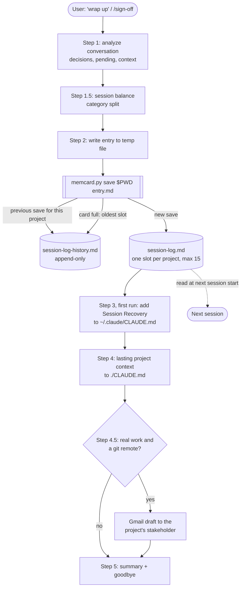

# sign-off

[](https://github.com/bolivarbryan/sign-off-skill/actions/workflows/ci.yml)


**End every Claude Code session with a save point: decisions, open tasks and project context go to a per-project memory card, so the next session starts where you left off.**

## Demo

```text
> wrap up, I'm heading out

## Session Summary

**Saved to session log:**
- Moved payment retries to an idempotent queue worker
- Chose exponential backoff (max 5 attempts) over a fixed delay

**Updated CLAUDE.md:**
- Added "retry policy lives in workers/retry.py" under Session Notes

**Report drafted:**
- To: Jane Doe <jane@example.com>, Gmail draft id r-8f3a2c

**Pending items:**
- [ ] Load-test the worker with 10k queued jobs

Session Balance
───────────────────────────────
technical  ██████████████░░░░░░  70%
planning   ████░░░░░░░░░░░░░░░░  20%
comms      ██░░░░░░░░░░░░░░░░░░  10%
───────────────────────────────

Until next time! Good luck with the load test tomorrow.
```

The next morning, a fresh session in the same repo reads the slot and opens with the
pending load test, the backoff decision and where the retry code lives.

Under the hood the save is a single, atomic CLI call:

```console
$ memcard.py save "$PWD" /tmp/entry.md
saved ~/code/checkout-service: overwrote slot (2026-11-17 18:05 -> history). 4/15 slots used.
```

## Install

### As a plugin (recommended)

Inside Claude Code:

```text
/plugin marketplace add bolivarbryan/sign-off-skill
/plugin install sign-off@sign-off-skill
```

On Claude Code 2.1.275 or later this is one step:

```text
/plugin install sign-off --marketplace bolivarbryan/sign-off-skill
```

The skill is then available as `/sign-off:sign-off`, and Claude also invokes it on
its own when you say things like "wrap up", "save and quit" or "cierra la sesión".

### As a plain skill

```bash
git clone https://github.com/bolivarbryan/sign-off-skill.git
cp -R sign-off-skill/skills/sign-off ~/.claude/skills/sign-off
```

Invoke it with `/sign-off`. Requires Python 3.10+ on `PATH`; no other dependencies.

## How it works



The session log works like a console memory card:

- **`~/.claude/session-log.md`** is the card. It holds a slot table and one slot per
  project (keyed by directory) with that project's latest session. It stays small, so
  it is cheap to read at the start of every conversation.
- **`~/.claude/session-log-history.md`** keeps every save that was overwritten or
  evicted. It is append-only and meant to be grepped, not read whole.
- **`memcard.py`** owns both files. Writes are atomic, and history is written before
  the card, so a crash can duplicate a save but never lose one.

The optional daily report drafts a scrum-style update from this session plus earlier
saves for the same git remote. It only ever creates a Gmail draft; you review and
send it. Recipients live in `~/.claude/report-recipients.json`.

**Never saved:** passwords, tokens, API keys, specific financial figures, ID numbers.

## Repository layout

```text
.
├── .claude-plugin/
│   ├── plugin.json            # plugin manifest
│   └── marketplace.json       # single-plugin marketplace (source: repo root)
├── skills/sign-off/
│   ├── SKILL.md               # the protocol Claude follows
│   ├── references/            # loaded on demand (progressive disclosure)
│   │   ├── session-balance.md
│   │   ├── session-log.md
│   │   └── daily-report.md
│   └── scripts/memcard.py     # memory-card CLI, standard library only
├── tests/test_memcard.py      # pytest suite
├── docs/design/               # specs and implementation plans
├── .github/workflows/ci.yml   # ruff + pytest on 3.10-3.13
└── pyproject.toml             # tool config (ruff, pytest)
```

## Contributing

Issues and pull requests are welcome.

```bash
python3 -m pip install pytest ruff
python3 -m pytest
ruff check . && ruff format --check .
claude plugin validate .        # plugin + marketplace manifests
```

Behavior changes to the protocol belong in `skills/sign-off/SKILL.md` (or the
matching file in `references/`); changes to how the card is stored belong in
`memcard.py` with a test. Larger changes start with a short spec in
[`docs/design/`](docs/design/).

## License

[MIT](LICENSE)
